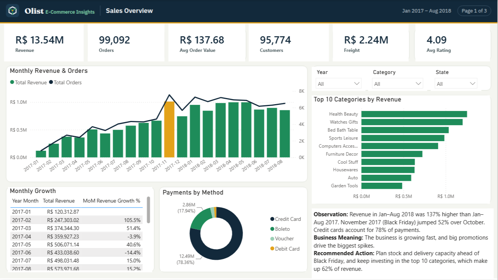
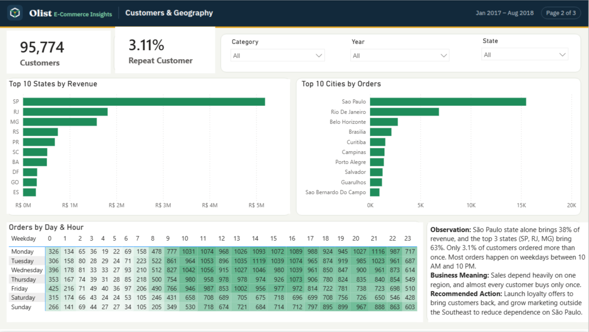
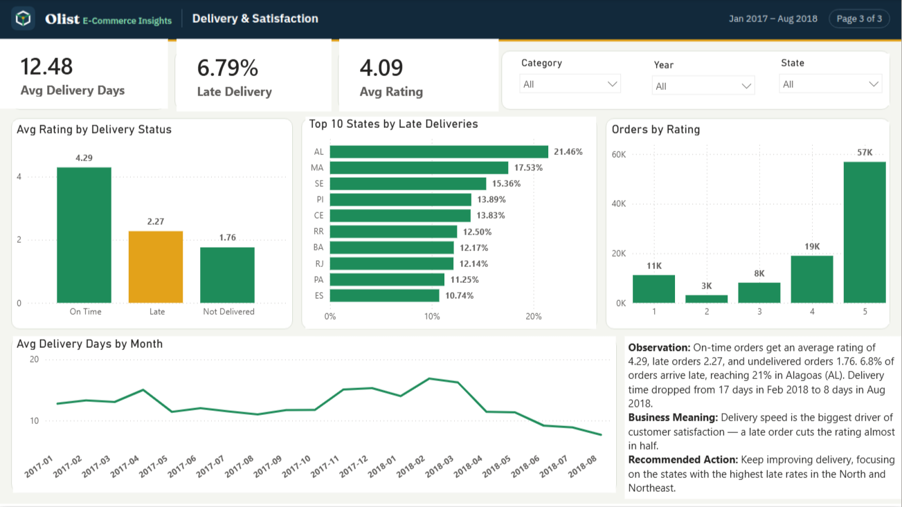

# Olist E-Commerce Insights — Power BI Dashboard

An end-to-end Power BI project analyzing **99,092 orders** from Olist, the largest e-commerce marketplace in Brazil (Jan 2017 – Aug 2018).
The dashboard answers three business questions:

1. **How are sales performing?**
2. **Where do customers come from, and do they come back?**
3. **Does delivery performance affect customer satisfaction?**

---

## Dataset

| Item | Details |
|---|---|
| Source | [Brazilian E-Commerce Public Dataset by Olist — Kaggle](https://www.kaggle.com/datasets/olistbr/brazilian-ecommerce) |
| Downloads on Kaggle | 650K+ |
| Tables used | 8 of 9 (geolocation excluded — not needed for the analysis) |
| Largest table | 112,650 order items |
| Period analyzed | Jan 2017 – Aug 2018 (20 complete months) |

---

## Tools

- **Power Query** — data cleaning and transformation
- **Power BI Data Model** — star schema and relationships
- **DAX** — measures, calculated columns, and a date table
- **Power BI Desktop** — interactive dashboard

---

## 1. Data Cleaning (Power Query)

Every step is named in *Applied Steps* so the process can be reviewed inside the `.pbix` file.

| Table | Cleaning steps |
|---|---|
| **orders** | Converted estimated delivery date to Date; removed 349 orders (0.35%) from incomplete months (late 2016 had a gap with zero orders in Nov, and Sep–Oct 2018 had only 20 orders); capitalized order status |
| **products** | Kept only needed columns (two original columns had a typo: `lenght`); merged with the translation table to get English category names; manually translated 2 categories missing from the translation table; filled 610 missing categories with "Unknown"; replaced underscores and capitalized names |
| **reviews** | Kept only needed columns (comment title was 88% empty); removed reviews of excluded orders; grouped to **one review per order** (551 orders had more than one review) |
| **order_items** | Removed items belonging to excluded orders |
| **payments** | Removed payments of excluded orders; removed 8 zero-value payments (including `not_defined` type); formatted payment type names |
| **customers / sellers** | Disabled automatic type detection to keep leading zeros in zip codes (e.g. `01310`); capitalized city names |

---

## 2. Data Model

Star schema with **3 fact tables** and **5 dimension tables**.

| Type | Tables |
|---|---|
| Fact | `fact_order_items` (main fact — every product sold with its price), `fact_payments`, `fact_reviews` |
| Dimension | `dim_orders`, `dim_customers`, `dim_products`, `dim_sellers`, `Dim_Date` |

**Modeling decisions:**
- Power BI auto-detected the `customers → orders` relationship as **one-to-one**, because Olist creates a new `customer_id` for every order. I changed it to **one-to-many**, and used `customer_unique_id` to count real customers (95,774, not 99,441).
- Set the `dim_orders ↔ fact_order_items` relationship to **both directions** so the category slicer filters orders, customers, and delivery metrics consistently.
- Created `Dim_Date` with DAX and marked it as the date table.

---

## 3. DAX

**Measures (13)**
`Total Revenue`, `Total Orders`, `Delivered Orders`, `Average Order Value`, `Total Customers`, `Repeat Customer Rate %`, `Avg Delivery Days`, `Late Delivery %`, `Avg Review Score`, `Total Freight`, `MoM Revenue Growth %`, plus formatted card measures.

**Calculated columns**
`Purchase Date`, `Purchase Hour`, `Delivery Days`, `Is Late`, `Delivery Status` (On Time / Late / Not Delivered), `Rating Stars`.

Example — repeat customer rate:
```DAX
Repeat Customer Rate % =
VAR RepeatCustomers =
    COUNTROWS(
        FILTER(
            VALUES(dim_customers[customer_unique_id]),
            CALCULATE(COUNTROWS(dim_orders)) > 1
        )
    )
RETURN DIVIDE(RepeatCustomers, [Total Customers])
```

---

## 4. Dashboard

Three interactive pages with synced slicers (Year, Category, State).

### Sales Overview


### Customers & Geography


### Delivery & Satisfaction


---

## Key Insights

| # | Insight | Recommendation |
|---|---|---|
| 1 | **Late delivery cuts ratings almost in half:** on-time orders average **4.29**, late orders **2.27**, undelivered orders **1.76**. | Prioritize delivery performance, especially in states with the highest late rates (Alagoas: 21%). |
| 2 | **Delivery is improving:** average delivery time dropped from **17 days (Feb 2018)** to **8 days (Aug 2018)**. | Keep investing in logistics — it directly drives satisfaction. |
| 3 | **Fast growth:** revenue in Jan–Aug 2018 was **137% higher** than Jan–Aug 2017; Black Friday (Nov 2017) jumped **52%** over October. | Plan stock and delivery capacity ahead of major promotions. |
| 4 | **Almost no repeat buyers:** only **3.1%** of customers ordered more than once. | Launch loyalty offers to bring customers back. |
| 5 | **Regional concentration:** São Paulo state brings **38%** of revenue; the top 3 states bring **63%**. | Grow marketing outside the Southeast. |

---

## Repository Contents

| File | Description |
|---|---|
| `Olist_Sales_Analysis.pbix` | Power BI project (cleaning steps, model, DAX, dashboard) |
| `*.csv` | Original raw data from Kaggle (8 tables) |
| `*.png` | Dashboard screenshots |

**To open:** download the `.pbix` file and open it in Power BI Desktop.

---

## Author

**[Samar Mohsen]** — Data Analysis Diploma, Smart Investment Solution (SIS)
[LinkedIn](https://www.linkedin.com/in/your-profile)
